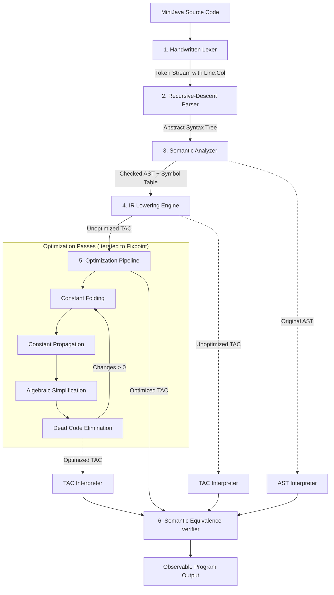

# MiniJava Optimizer — Compiler Optimization Learning System

An educational compiler and intermediate representation (IR) optimization system written in **Java 21**, built with **Maven** and **JUnit 5**. Designed specifically to explore foundational compiler design and program optimization algorithms relevant to compiler research (such as an IIT Bombay compiler optimization research internship).

---

## 1. Project Overview

The **MiniJava Optimizer** demonstrates how high-level source code is progressively tokenized, parsed into an Abstract Syntax Tree (AST), checked for semantic correctness, lowered into linear **Three-Address Code (TAC)**, and optimized through a multi-pass optimization pipeline driven to a fixpoint.

### Core Capabilities
* **Handwritten Recursive-Descent Parser:** LL(1) grammar support with precedence climbing and source location tracking (1-based line and column).
* **Static Semantic Analyzer:** Symbol table management, duplicate declaration detection, undeclared variable detection, and definite assignment enforcement.
* **Three-Address Code (TAC) Intermediate Representation:** Explicit compiler temporaries and human-readable assembly-like representation.
* **Multi-Pass Optimization Engine:**
  * **Constant Folding (CF):** Compile-time arithmetic reduction with integer wrap-around and zero-division exception preservation.
  * **Constant Propagation (CP):** Forward dataflow tracking of constant values through variables and temporaries.
  * **Algebraic Simplification (AS):** Safe mathematical identity elimination ($x + 0 \to x$, $x \times 1 \to x$, $x - x \to 0$, $x \times 0 \to 0$, $x / 1 \to x$, $x \pmod 1 \to 0$).
  * **Dead Code Elimination (DCE):** Backward liveness analysis ($\text{Live}_{in} = \text{Gen} \cup (\text{Live}_{out} \setminus \text{Kill})$) removing unused variables while strictly preserving observable print statements and potential faulting instructions.
  * **Optimization Pipeline Orchestrator:** Iterative pass execution until fixpoint convergence.
* **Dual Execution & Verification Engines:**
  * Tree-walking AST Interpreter.
  * TAC Virtual Machine Interpreter.
  * Semantic Equivalence Verifier comparing execution traces and confirming that optimizations preserve original program behavior.
* **Complete Command-Line Interface & REPL:** Tokenize, parse, inspect IR, run individual or combined passes, execute programs, and compare before/after optimizations side-by-side.

---

## 2. Language Grammar (EBNF)

MiniJava implements a focused imperative integer-arithmetic language:

```ebnf
Program            ::= Statement* EOF
Statement          ::= VarDeclStatement
                     | AssignStatement
                     | PrintStatement

VarDeclStatement   ::= "int" IDENTIFIER ( "=" Expression )? ";"
AssignStatement    ::= IDENTIFIER "=" Expression ";"
PrintStatement     ::= "print" "(" Expression ")" ";"

Expression         ::= AdditiveExpr
AdditiveExpr       ::= MultiplicativeExpr ( ( "+" | "-" ) MultiplicativeExpr )*
MultiplicativeExpr ::= UnaryExpr ( ( "*" | "/" | "%" ) UnaryExpr )*
UnaryExpr          ::= ( "-" | "+" ) UnaryExpr | PrimaryExpr
PrimaryExpr        ::= INT_LITERAL
                     | IDENTIFIER
                     | "(" Expression ")"
```

### Lexical Specification
* **Keywords:** `int`, `print`
* **Identifiers:** `[a-zA-Z_][a-zA-Z0-9_]*`
* **Integer Literals:** `[0-9]+` (parsed as signed 32-bit two's complement integers)
* **Operators:** `+`, `-`, `*`, `/`, `%`, `=`
* **Punctuation:** `(`, `)`, `;`
* **Comments:**
  * Single-line: `// ... \n`
  * Multi-line block: `/* ... */`
* **Coordinates:** Every token retains exact 1-based `line:column` coordinates.

---

## 3. Architecture Pipeline



### Module Responsibilities

| Package | Key Classes | Responsibilities |
| :--- | :--- | :--- |
| `minijava.lexer` | `Lexer`, `Token`, `TokenType`, `SourceLocation` | Character streaming, whitespace/comment filtering, coordinate tracking, lexical diagnostic reporting. |
| `minijava.ast` | `Program`, `Statement`, `Expression`, `AstVisitor`, `AstPrinter` | Strongly typed node records, visitor traversal pattern, formatted ASCII tree rendering. |
| `minijava.parser` | `Parser`, `ParseException` | LL(1) recursive descent, precedence climbing, explicit syntax error recovery messages. |
| `minijava.semantic` | `SemanticAnalyzer`, `SymbolTable`, `Symbol`, `SemanticError` | Scope management, variable lookup, duplicate declaration detection, definite assignment verification. |
| `minijava.ir` | `Operand`, `TacInstruction`, `TacProgram`, `IrGenerator`, `TempGenerator` | Lowering AST expressions into linear Three-Address Code with explicit temporaries (`t0`, `t1`, ...). |
| `minijava.optimizer` | `OptimizationPipeline`, `ConstantFoldingPass`, `ConstantPropagationPass`, `AlgebraicSimplificationPass`, `DeadCodeEliminationPass` | Dataflow optimization passes, backward liveness analysis, fixpoint convergence, transformation logging. |
| `minijava.interpreter` | `AstInterpreter`, `TacInterpreter`, `SemanticEquivalenceVerifier`, `ExecutionResult` | Reference AST interpretation, virtual TAC execution, automated side-by-side behavioral equivalence verification. |
| `minijava.cli` | `MiniJavaCli` | Comprehensive CLI subcommands (`tokenize`, `parse`, `check`, `ir`, `optimize`, `run`, `compare`, `repl`). |

---

## 4. Intermediate Representation: Three-Address Code (TAC)

In Three-Address Code, every instruction has at most one operator and at most three operands (one destination and up to two sources):

```
dest = left op right
dest = op operand
dest = src
print operand
```

### Operands
* `Constant(int value)`: E.g., `42`, `-5`.
* `Variable(String name)`: Program variable, e.g., `a`, `score`.
* `Temporary(int id)`: Compiler-generated temporary register, e.g., `t0`, `t1`.

### Lowering Walkthrough
Given:
```java
int a = 2 + 3;
int b = a * 4;
print(b);
```
Lowered Three-Address Code:
```
  1:  t0 = 2 + 3
  2:  a = t0
  3:  t1 = a * 4
  4:  b = t1
  5:  print b
```

---

## 5. Optimization Algorithms & Theoretical Foundations

### 5.1 Constant Folding (`ConstantFoldingPass`)
* **Concept:** Evaluates operations whose operands are statically known constants at compile time.
* **Formal Transformation:**
  $$\text{Binary}(dest, \oplus, c_1, c_2) \implies \text{Assign}(dest, c_1 \oplus c_2)$$
* **Zero-Division Exception Safety:**
  If the operator is `/` or `%` and the divisor $c_2 = 0$, the pass **strictly refrains from folding**. The division instruction remains in the IR to ensure the program throws a runtime `ArithmeticException` at the exact execution sequence specified by the source code.

### 5.2 Constant Propagation (`ConstantPropagationPass`)
* **Concept:** Replaces occurrences of variable/temporary operands with their known constant values based on reaching assignments.
* **Lattice Model:**
  For each variable $x$, values belong to the flat constant lattice:
  $$\top \text{ (unassigned/unknown)} \quad \longrightarrow \quad c \in \mathbb{Z} \text{ (known constant)} \quad \longrightarrow \quad \bot \text{ (overwritten/dynamic)}$$
* **Transfer Rule:**
  * When $x = c$ is encountered, record $x \mapsto c$.
  * For any instruction $i$ using $x$, replace $x$ with $c$.
  * If $x$ is assigned a dynamic value ($x = \dots$), invalidate $x$ from the reaching constant store.

### 5.3 Algebraic Simplification (`AlgebraicSimplificationPass`)
* **Concept:** Exploits mathematical algebraic identities to eliminate redundant operations:
  * $x + 0 \implies x$
  * $0 + x \implies x$
  * $x - 0 \implies x$
  * $x - x \implies 0$
  * $x \times 1 \implies x$
  * $1 \times x \implies x$
  * $x \times 0 \implies 0$
  * $0 \times x \implies 0$
  * $x / 1 \implies x$
  * $x \pmod 1 \implies 0$
  * $+x \implies x$
* **Safety:** Note that $x / x \to 1$ and $0 / x \to 0$ are **intentionally omitted** because if $x = 0$ at runtime, evaluating $0/0$ must trigger an `ArithmeticException`. Eliminating it would unsafely alter observable program semantics.

### 5.4 Dead Code Elimination (`DeadCodeEliminationPass`)
* **Concept:** Removes instructions whose computed results are never read by any subsequent instruction.
* **Algorithm (Backward Liveness Analysis):**
  1. Initialize $\text{Live} = \emptyset$.
  2. Traverse instructions backwards from index $N-1$ down to $0$:
     * If instruction is `print(u)`:
       Mark as live. $\text{Live} \gets \text{Live} \cup \{ u \}$.
     * If instruction defines `dest`:
       * If $dest \in \text{Live}$:
         Keep instruction. $\text{Live} \gets (\text{Live} \setminus \{dest\}) \cup \text{uses}(inst)$.
       * If $dest \notin \text{Live}$:
         * If instruction is pure (cannot fault): **Eliminate instruction!**
         * If instruction may fault (e.g. division by dynamic/zero divisor) and exception preservation is active: **Retain instruction!**

### 5.5 Fixpoint Convergence
Because individual passes uncover optimization opportunities for subsequent passes (e.g., Constant Folding creates constants for Constant Propagation, which in turn enables more Constant Folding and exposes Dead Code), the passes are composed into an iterative pipeline:

$$\text{Program}_0 \xrightarrow{\text{CF}} \text{Program}_1 \xrightarrow{\text{CP}} \text{Program}_2 \xrightarrow{\text{AS}} \text{Program}_3 \xrightarrow{\text{DCE}} \text{Program}_4$$

The loop terminates when an entire iteration produces **zero modifications** ($\Delta = 0$), guaranteeing that the intermediate representation has reached a fixed point.

---

## 6. Build, Setup & Testing

### Prerequisites
* **Java 21** or higher (`java -version`)
* **Maven 3.8+** (or use the included `mvnw.cmd` / `mvnw` scripts)

### Build the Project
```powershell
# Using installed Maven
mvn clean compile

# Or using the included wrapper on Windows
.\mvnw.cmd clean compile
```

### Run All JUnit 5 Tests
```powershell
mvn test
```
The test suite executes 53 comprehensive unit and integration tests across:
* `LexerTest`: coordinate tracking, token types, comment handling, overflow checks.
* `ParserTest`: precedence climbing, associativity, grouped expressions, syntax diagnostics.
* `SemanticAnalyzerTest`: duplicate checks, scope verification, uninitialized variable checks.
* `IrGeneratorTest`: TAC instruction lowering, register allocation.
* `ConstantFoldingPassTest`: arithmetic folding, division-by-zero protection.
* `ConstantPropagationPassTest`: single and chained forward propagation.
* `AlgebraicSimplificationPassTest`: identity simplifications.
* `DeadCodeEliminationPassTest`: backward liveness, side-effect preservation.
* `OptimizationPipelineTest`: fixpoint iteration, user example reduction.
* `InterpreterTest`: AST & TAC interpretation, behavioral equivalence.
* `MiniJavaWebServerTest`: HTTP endpoints, compiler JSON API, HTML serving.
* `EndToEndIntegrationTest`: complete multi-file compilation pipelines.

### Package Executable JAR
```powershell
mvn package
```
Generates `target/minijava-optimizer-1.0.0.jar`.

---

## 7. CLI Usage & Demonstration

### 1. Side-by-Side Comparison & Verification (`compare`)
```powershell
java -jar target/minijava-optimizer-1.0.0.jar compare examples/01_prompt_example.minij
```
**Output:**
```
=================================================
       MINIJAVA OPTIMIZATION COMPARISON          
=================================================

--- SOURCE CODE ---
int a = 2 + 3;
int b = a * 4;
print(b);

--- ORIGINAL TAC (5 instructions) ---
  1:  t0 = 2 + 3
  2:  a = t0
  3:  t1 = a * 4
  4:  b = t1
  5:  print b

--- OPTIMIZED TAC (1 instructions) ---
  1:  print 20

--- OPTIMIZATION METRICS ---
Optimization Summary: 5 -> 1 instructions (80.0% reduction) across 3 iteration(s)

--- SEMANTIC EQUIVALENCE & OUTPUT ---
=== Semantic Equivalence Verification ===
Status: PASSED (Observable behavior strictly preserved)
Details: All outputs match identically across AST, unoptimized TAC, and optimized TAC.
Original TAC steps: 5 | Optimized TAC steps: 1 (Delta: 4 steps)
Standard output produced:
  > 20
```

### 2. Inspect Transformation Steps (`optimize --steps`)
```powershell
java -jar target/minijava-optimizer-1.0.0.jar optimize examples/01_prompt_example.minij --steps
```
**Output:**
```
=== Optimization Pipeline Report ===
Optimization Summary: 5 -> 1 instructions (80.0% reduction) across 3 iteration(s)

--- Iteration 1 ---
  [Constant Folding]: 1 change(s)
    * Folded binary expression: 't0 = 2 + 3' -> 't0 = 5'
  [Constant Propagation]: 2 change(s)
    * Propagated constant: 'a = t0' -> 'a = 5'
    * Propagated constant: 't1 = a * 4' -> 't1 = 5 * 4'
  [Dead Code Elimination]: 2 change(s)
    * Eliminated dead instruction: 'a = 5'
    * Eliminated dead instruction: 't0 = 5'
--- Iteration 2 ---
  [Constant Folding]: 1 change(s)
    * Folded binary expression: 't1 = 5 * 4' -> 't1 = 20'
  [Constant Propagation]: 2 change(s)
    * Propagated constant: 'b = t1' -> 'b = 20'
    * Propagated constant: 'print b' -> 'print 20'
  [Dead Code Elimination]: 2 change(s)
    * Eliminated dead instruction: 'b = 20'
    * Eliminated dead instruction: 't1 = 20'
```

### 3. Display Abstract Syntax Tree (`parse`)
```powershell
java -jar target/minijava-optimizer-1.0.0.jar parse examples/01_prompt_example.minij
```
**Output:**
```
Program [6:1]
+-- VarDecl: int a [6:1]
|   \-- init: Binary(+) [6:11]
|       +-- left: IntLiteral(2) [6:9]
|       \-- right: IntLiteral(3) [6:13]
+-- VarDecl: int b [7:1]
|   \-- init: Binary(*) [7:11]
|       +-- left: VarRef(a) [7:9]
|       \-- right: IntLiteral(4) [7:13]
\-- Print [8:1]
    \-- expr: VarRef(b) [8:7]
```

### 4. Interactive REPL (`repl`)
```powershell
java -jar target/minijava-optimizer-1.0.0.jar repl
```
Allows real-time input:
```
minijava> int x = 10 * 5; print(x + 0);
  Original TAC:  [t0 = 10 * 5, x = t0, t1 = x + 0, print t1]
  Optimized TAC: [print 50]
  Program Output: [50]
```

### 5. Interactive Web Frontend & Compiler Visualizer (`ui` or `web`)
```powershell
java -jar target/minijava-optimizer-1.0.0.jar ui
# or specify a custom port:
java -jar target/minijava-optimizer-1.0.0.jar ui 8080
```
Launches an embedded HTTP server (zero external dependencies, powered by Java 21 standard library `com.sun.net.httpserver`) and opens the Web Visualizer at `http://localhost:8080`.
* **Features:**
  * In-browser MiniJava source editor with sample loader.
  * Side-by-side Three-Address Code comparison (Original vs. Optimized) with syntax badges and reduction metrics.
  * **Interactive Pass Stepper:** Step through each pass (CF $\to$ CP $\to$ AS $\to$ DCE) iteration-by-iteration with live diffs.
  * Live Abstract Syntax Tree viewer.
  * Symbol Table and Token Stream inspector.
  * Execution output console and semantic equivalence verification badge.

---

## 8. Sample Program Portfolio

All example programs reside in [`examples/`](file:///d:/project/MiniJ%20compiler/examples):

1. **[`01_prompt_example.minij`](file:///d:/project/MiniJ%20compiler/examples/01_prompt_example.minij):** The classic assignment example reducing from 5 TAC instructions to `print 20` (80.0% reduction).
2. **[`02_constant_folding.minij`](file:///d:/project/MiniJ%20compiler/examples/02_constant_folding.minij):** Multi-operator constant expression evaluation with modular arithmetic.
3. **[`03_constant_propagation.minij`](file:///d:/project/MiniJ%20compiler/examples/03_constant_propagation.minij):** Chained forward propagation through multiple variable references.
4. **[`04_algebraic_identities.minij`](file:///d:/project/MiniJ%20compiler/examples/04_algebraic_identities.minij):** Demonstrates identities ($x+0$, $x \times 1$, $x - x$, $x \times 0$) reducing 14 TAC instructions to 3.
5. **[`05_dead_code_elimination.minij`](file:///d:/project/MiniJ%20compiler/examples/05_dead_code_elimination.minij):** Dead computation trees stripped while retaining live print operations.
6. **[`06_combined_pipeline.minij`](file:///d:/project/MiniJ%20compiler/examples/06_combined_pipeline.minij):** Large compound pipeline achieving 90.9% reduction.
7. **[`07_division_by_zero_safety.minij`](file:///d:/project/MiniJ%20compiler/examples/07_division_by_zero_safety.minij):** Demonstrates runtime exception preservation across AST, unoptimized TAC, and optimized TAC.

---

## 9. Design Decisions, Trade-Offs & Limitations

1. **Straight-Line Three-Address Code vs. Control Flow Graphs (CFG):**
   * *Decision:* Implemented straight-line Three-Address Code (single basic block per program).
   * *Rationale:* Allows clean, unambiguous demonstration of intra-block dataflow analysis, lattice-based constant propagation, and liveness analysis without requiring phi-functions or dominator trees, while maintaining absolute mathematical rigor.
2. **Preserving Faulting Operations:**
   * *Decision:* In `ConstantFoldingPass` and `DeadCodeEliminationPass`, divisions by zero or unknown divisors are retained.
   * *Rationale:* In standard compiler specifications (e.g. JVM specification), division by zero must raise an `ArithmeticException`. Eliminating dead divisions that throw would alter the observable execution behavior.
3. **Integer Arithmetic Semantics:**
   * *Decision:* Standard Java 32-bit two's complement integer arithmetic with wrap-around.
   * *Explicit Limitation:* Does not implement floating-point types, heap allocations, object references, or Java value types.

---

## 10. IIT Bombay Compiler Optimization Research Interview Q&A

### Q1: What is Three-Address Code (TAC), and why is it preferred over directly optimizing an Abstract Syntax Tree (AST)?
**Answer:**
An AST is hierarchical and reflects the source language's syntactic structure, making complex transformations difficult because nested expressions have unbounded depth and arbitrary side effects. Three-Address Code linearizes nested expressions into discrete instructions containing at most one operator and three addresses (destination, left operand, right operand). This regular structure decouples the optimization engine from high-level syntax, makes definition-use chains straightforward to track, models machine-level register constraints more accurately, and allows uniform transfer functions in dataflow analysis.

### Q2: How does Dead Code Elimination (DCE) use backward liveness analysis? What are the Gen and Kill sets?
**Answer:**
Liveness is a backward dataflow property: a variable $v$ is live at point $p$ if there is an execution path from $p$ to a read of $v$ without an intervening redefinition.
* **$\text{Kill}(i)$:** The set of variables defined (written to) by instruction $i$. For $x = y + z$, $\text{Kill} = \{x\}$.
* **$\text{Gen}(i)$:** The set of variables read (used) by instruction $i$. For $x = y + z$, $\text{Gen} = \{y, z\}$.
* **Dataflow Equation:**
  $$\text{Live}_{in}[i] = \text{Gen}[i] \cup (\text{Live}_{out}[i] \setminus \text{Kill}[i])$$
An assignment $x = \dots$ is dead if $x \notin \text{Live}_{out}[i]$ and the instruction has no observable side effects (such as I/O or throwing an exception).

### Q3: What is the "Phase Ordering Problem" in optimizing compilers? How is it handled in MiniJava?
**Answer:**
The Phase Ordering Problem arises because compiler passes interact: the order in which optimization passes are executed determines which opportunities are discovered. For instance, Constant Folding cannot fold $b = a * 4$ until Constant Propagation has replaced $a$ with $5$. Conversely, Constant Propagation cannot propagate $b = 20$ until Constant Folding has evaluated $5 * 4$. In MiniJava, this is solved by iterating the pass pipeline ($\text{CF} \to \text{CP} \to \text{AS} \to \text{DCE}$) in a loop until a fixed point is reached (where no pass produces changes), ensuring that all interdependent optimizations are fully realized.

### Q4: Why must an optimizer be cautious about simplifying $x / x \to 1$ or $0 / x \to 0$?
**Answer:**
While algebraically valid for non-zero reals, in integer computer arithmetic, division by zero triggers an exceptional control flow (`ArithmeticException`). If the program variable $x$ evaluates to $0$ at runtime, the original unoptimized program would abort with an exception. If the compiler statically replaced $x / x$ with $1$, the optimized program would execute silently and produce an incorrect result, violating the fundamental compiler correctness criterion: **optimizations must preserve observable program semantics**.

### Q5: How would you extend this linear IR to Static Single Assignment (SSA) form?
**Answer:**
In SSA form, every variable is assigned exactly once, and $\phi$ (phi) functions are placed at control flow join points (join nodes in the Control Flow Graph). To extend MiniJava TAC to SSA:
1. Construct basic blocks and build a Control Flow Graph with edges representing branch targets.
2. Compute the Dominator Tree and dominance frontiers ($DF$).
3. Place $\phi$-functions at the dominance frontiers of blocks containing variable assignments.
4. Rename variable definitions using version indices ($x_1, x_2, \dots$) and rename uses to match the reaching definition.
In SSA, constant propagation becomes sparse (Sparse Conditional Constant Propagation - SCCP), allowing constant folding and unreachable code elimination to be performed simultaneously in linear time.
